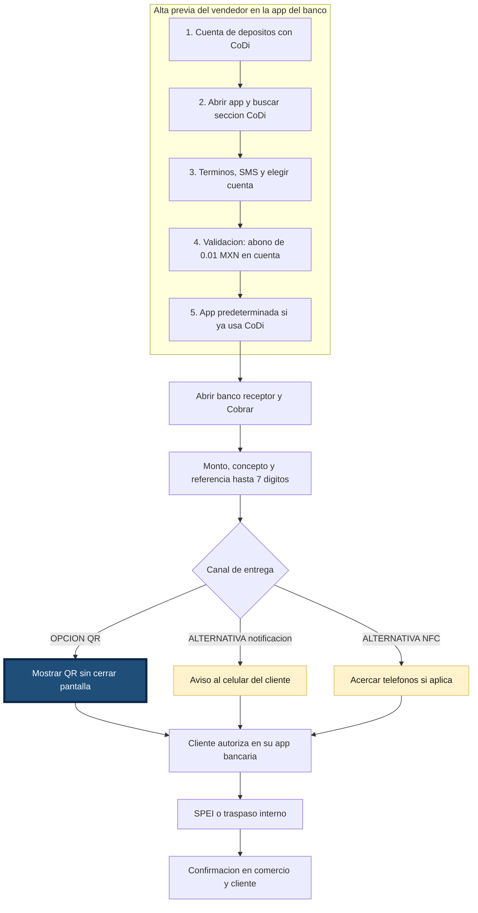
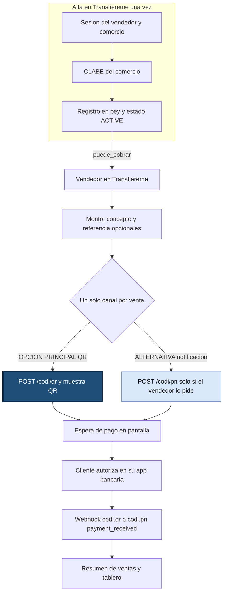

# Transfiéreme

**Capa de cobro CoDi para el pequeño comercio: un QR general en el local, un QR por venta, y un tablero que agrupa lo cobrado.**

Proyecto para el **DevDay Exchange Community Hackathon CDMX** (7 de noviembre de 2026, UTOPÍA Elena Poniatowska, Coyoacán). Organizan AI Builders México, UTOPÍAS, SEDECO y pey.

Reto: construir con CoDi usando la API abierta de pey. Documentación: [https://docs.pey.mx](https://docs.pey.mx). Base: `https://api.pey.mx`.

**En producción:** [https://transfiereme.asware.com.mx/](https://transfiereme.asware.com.mx/)

## Problema

Cobrar con CoDi sigue pidiendo demasiados pasos dentro de la app del banco, y el efectivo sigue dominando los pagos chicos.

Datos de contexto (sin métricas propias del proyecto):

- Según *Mexico Business News* (28 de septiembre de 2026), CoDi tiene **23.2 millones de cuentas validadas**, frente a una meta de **37 millones**.
- Métricas de Banxico sobre la experiencia en la app del banco: encontrar CoDi toma **1–2 toques**, generar un cobro **2–4 toques** y pagar escaneando un QR **2–3 toques**.
- Solo **25 de 48** instituciones con transferencias móviles ofrecen CoDi.
- La ENIF 2024 del INEGI indica que el **85%** de las compras de **$500 o menos** se pagan en efectivo.
- La Circular 9/2026 de Banxico obliga a homologar la experiencia de transferencias y CoDi en móvil para el **14 de diciembre de 2026**.

Transfiéreme apunta a esa fricción desde el lado del proveedor: el pequeño comercio cobra sin recorrer los menús de su banco.

## CoDi en el banco frente a Transfiéreme

Comparación autocontenida. El recorrido **sin esta app** resume la hoja «Pasos y fricción» de [flujo-codi-actual.drawio](docs/flujos-de-trabajo/flujo-codi-actual.drawio). El recorrido **con Transfiéreme** sigue lo documentado e implementado en este repositorio (véase [Flujo de usuario](#flujo-de-usuario), [Solución](#solución) y [cuenta-pey-api.md](docs/desarrollo/cuenta-pey-api.md)); el cliente sigue autorizando en su app bancaria.

### Antes: cobro en la app del banco (sin Transfiéreme)

Referencia de fricción de caja, no un manual de cada banco. En cada venta quien cobra opera dentro de su app bancaria. QR, notificación y NFC son **alternativas excluyentes** por cobro (no consecutivas ni simultáneas).



La validación del alta es un **abono de $0.01** en la cuenta; no es un cobro CoDi entregado por SMS.

### Después: cobro con Transfiéreme (documentado e implementado)

El vendedor no abre la app del banco para armar cada cobro. Hace falta cuenta **ACTIVE** en pey (`puede_cobrar`) tras registrar la CLABE del comercio; hasta entonces la app no dispara cobros reales.



- **QR por venta** es la opción principal en el flujo de cobro; la notificación solo si el vendedor la elige (no automática ni en paralelo con el QR).
- **QR general** del local y **NFC** del pagador sobre el mismo QR siguen en [Solución](#solución); pey no expone un endpoint NFC aparte.

## Alcance

La app es del **vendedor**, en pequeños comercios. El alcance es la **capa de cobro**. El punto de venta (inventario, ticket, caja) queda fuera.

## Solución

El vendedor tiene dos QR:

- **QR general.** Se publica en el establecimiento. Quien quiera pagar directo lo lee con su app bancaria y teclea el monto. El vendedor no arma esa venta.
- **QR por venta.** Se crea en cada cobro. El vendedor captura el monto y, si quiere, un concepto y una referencia. Transfiéreme pide el cobro a pey y muestra el QR. El cliente lo lee con su app bancaria, lo acepta por NFC, o el vendedor pide el número y manda el cobro por notificación push.

pey confirma el abono con webhooks:

- `codi.qr.payment_received`
- `codi.pn.payment_received`

Con esos cobros, Transfiéreme arma un **resumen de ventas** y un **tablero** que agrupa lo cobrado por concepto, día y canal (QR general, QR por venta, notificación).

### Concepto por defecto: "Transferencia"

Todo cobro sin concepto queda como **"Transferencia"**:

- El QR general siempre lleva "Transferencia", porque el vendedor no arma esa venta.
- En un QR por venta o una notificación, si el vendedor deja el concepto vacío, Transfiéreme manda "Transferencia".

El concepto que ve el vendedor es el que se envió al pagador. Después de cobrado no se renombra. El tablero agrupa con ese concepto.

## Flujo de usuario

Recorrido en [producción](https://transfiereme.asware.com.mx/):

1. El vendedor abre Transfiéreme.
2. Muestra el QR general ya publicado, o arma una venta: monto obligatorio, concepto y referencia opcionales.
3. En la venta, el cliente paga de una de estas formas: lee el QR con su app, acerca el teléfono (NFC) o recibe una notificación en el número que dio el vendedor.
4. pey avisa a Transfiéreme con `codi.qr.payment_received` o `codi.pn.payment_received`.
5. El resumen lista el movimiento con su concepto ("Transferencia" si no tenía) y el tablero actualiza los totales.

Si el pago no llega, la pantalla se queda en espera hasta que el cobro expira.

## Arquitectura

El contrato de movimientos y cobros está en [docs/stack-tecnologico/000-stack.md](docs/stack-tecnologico/000-stack.md#contrato-transversal-de-movimientos-y-cobros). En producción:

```text
Vendedor (QR general o venta: monto, concepto, referencia)
        │
        ▼
Transfiéreme
  ├── QR general publicado en el local   (POST /codi/qr, amount 0, sin expiración)
  ├── POST /codi/qr   → QR de esa venta (el cliente lo lee o lo acepta por NFC)
  └── POST /codi/pn   → cobro al número del cliente
        │
        ▼
pey  ──webhooks──►  Transfiéreme
     codi.qr.payment_received
     codi.pn.payment_received
        │
        ▼
Resumen de ventas y tablero
  agrupado por concepto (editable), día y canal
```

- **Cobro:** la app llama la API de pey (`https://api.pey.mx`). `POST /codi/qr` arma el QR de la venta y el QR general. `POST /codi/pn` manda la notificación al celular. El NFC lo resuelve la app bancaria del cliente sobre ese mismo cobro; pey no tiene un endpoint de NFC. El contrato verificado está en [docs/stack-tecnologico](docs/stack-tecnologico/000-stack.md#cobros-api-de-pey).
- **Webhooks:** el endpoint en Django recibe `codi.qr.payment_received` y `codi.pn.payment_received`, verifica la firma y marca el cobro como pagado. Quedan fallas conocidas; ver [limitaciones](#limitaciones-conocidas).
- **Espera en pantalla:** la app consulta a Django cada pocos segundos; Django responde con lo que llegó por webhook y, como respaldo, con `GET /transaction/...` de pey.
- **Tablero:** suma por concepto normalizado (minúsculas, sin espacios sobrantes), día y canal. Es una consulta a Postgres.

## Stack

Transfiéreme usa Flutter (web y Android), Django 6 + DRF, Postgres 17, sesión por cookie y Gunicorn, más la API de pey para el cobro. El detalle y las versiones están en [docs/stack-tecnologico](docs/stack-tecnologico/000-stack.md).

La instancia pública corre en [https://transfiereme.asware.com.mx/](https://transfiereme.asware.com.mx/). En local sigue el mismo stack (Flutter web/Android, Django 6 + DRF, Postgres 17 en Docker).

| Capa | Elección |
| --- | --- |
| App | Flutter (web y Android) |
| API | Django 6 + Django REST Framework, Python 3.12 |
| Datos | PostgreSQL 17 |
| Cobros | API de pey (`https://api.pey.mx`: `POST /codi/qr`, `POST /codi/pn`) |
| Confirmación | Webhook en el mismo Django, firmado con Standard Webhooks |

## Cómo correrlo

Estos pasos son para quien ya tiene autorización de los titulares. El código no se puede copiar, modificar ni redistribuir sin ese permiso; ver [licencia](#licencia).

Requisitos: Docker, Python 3.12, Flutter 3.47.x (ver [stack](docs/stack-tecnologico/000-stack.md)).

1. Clonar el repositorio.
2. Ejecutar `./scripts/upgrade.sh` (venv en `backend/.venv`, dependencias y `flutter pub get`).
3. Copiar `backend/.env.example` a `backend/.env` y ajustar valores **locales** (sin credenciales de pey; véase [variables de entorno](docs/desarrollo/variables-entorno.md)).
4. Ejecutar `./scripts/dev-start.sh` (incluye Postgres vía Compose en el puerto **5433**, migraciones, Django, Flutter web y proxy). Cuando el script confirme la API, use **http://127.0.0.1:8000** (origen único). Prueba: `curl http://127.0.0.1:8000/api/salud/`. La primera vez, Flutter puede seguir compilando unos minutos aunque la API ya responda.

Las variables de producción, prueba y deploy están en [variables de entorno](docs/desarrollo/variables-entorno.md). Estado de cuenta pey, registro y sincronización desde la app: [cuenta-pey-api.md](docs/desarrollo/cuenta-pey-api.md).

## Nota de pruebas

pey se prueba en **producción** (el ambiente de pruebas de pey todavía no está disponible). Usar montos de **$0.01**; lo que se paga no se devuelve.

Comprobaciones locales: `manage.py check`, `manage.py test config.tests`, `flutter analyze` y un smoke test en `frontend/test/widget_smoke_test.dart`. El cobro de punta a punta se ejercita en [producción](https://transfiereme.asware.com.mx/).

## Limitaciones conocidas

- No hay reintento, cancelación ni conciliación.
- Los webhooks con firma verificada y la demo de punta a punta quedaron listos con fallas el día del hackatón.

## Resultado del hackatón

Plan del 7 de noviembre de 2026. El producto en producción está en [https://transfiereme.asware.com.mx/](https://transfiereme.asware.com.mx/). 

| Bloque | Qué se busca                                                                          | Estado             |
| ------ | ------------------------------------------------------------------------------------- | ------------------ |
| 1      | Llaves, túnel, webhook registrado en el portal y un `POST /codi/qr` de $0.01          | Listo              |
| 2      | QR general para publicar en el local (`amount: 0`, concepto "Transferencia")          | Listo              |
| 3      | QR por venta: monto, concepto y referencia opcionales                                 | Listo              |
| 4      | `POST /codi/pn` al número del cliente, y espera del pago (QR, NFC o notificación)     | Listo              |
| 5      | Webhooks `codi.qr.payment_received` y `codi.pn.payment_received` con firma verificada | Listo, con fallas. |
| 6      | Resumen de ventas, edición del concepto y tablero por concepto, día y canal           | Listo              |
| 7      | Demo de punta a punta con un cobro de $0.01                                           | Listo, con fallas. |

## Contribuidores

| Nombre | Rol | GitHub |
| --- | --- | --- |
| Rodrigo Armenta | Forward Deployment Engineer | [rarmentas](https://github.com/rarmentas) |
| Ariel Martinez | Forward Deployment Engineer | [Ariel-MG](https://github.com/Ariel-MG) |

## Licencia

Copyright (c) 2026 Asware. Todos los derechos reservados. El texto completo está en [LICENSE](LICENSE).

El aviso cubre el código de este repositorio. No cubre las marcas CoDi y Banxico, ni la API ni la marca de pey. Las dependencias se rigen por sus propias licencias.
