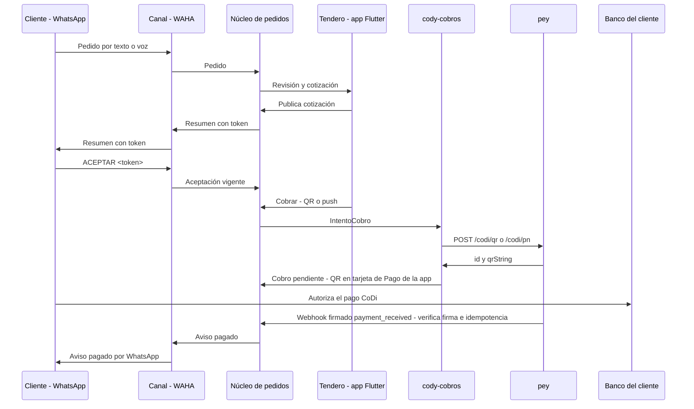
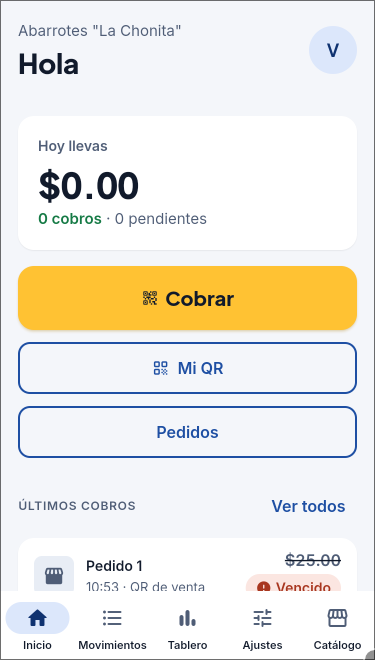
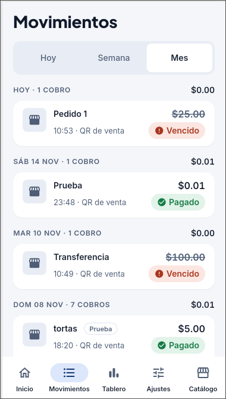
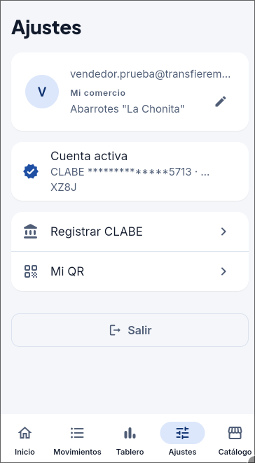
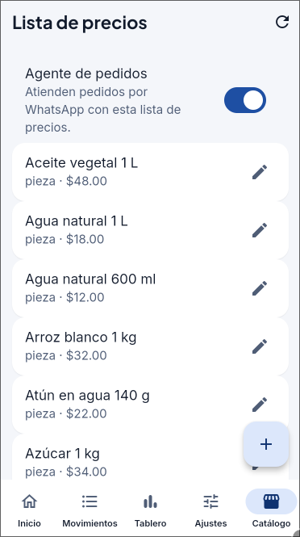

# Transfiéreme

**El tendero recibe pedidos por WhatsApp y cobra con CoDi, sin terminal ni comisiones.**

El cliente pide por WhatsApp, por texto o nota de voz. El tendero revisa y cotiza en la app; el cliente acepta con `ACEPTAR <token>`. El cobro CoDi sale por la API de pey y un webhook firmado marca el pedido como pagado.

[Conoce Transfiéreme en producción](https://transfiereme.asware.com.mx/).

Equipo: Rodrigo Armenta y Ariel Martinez (ver [Contribuidores](#contribuidores))

> 🎬 **Video de 3 minutos:** próximamente. <!-- TODO(Rodrigo): reemplazar con la liga del video o GIF -->

## Hackatón México

Este repositorio es el entregable del **Cursor Hackatón México: Ciudad de México**, continuación del DevDay Exchange Community Hackathon CDMX del 7 de noviembre de 2026, donde Transfiéreme obtuvo el **tercer lugar**. El periodo de construcción es del **14 de noviembre al 12 de diciembre de 2026**; la entrega preliminar de Fase 1 es el **15 de noviembre** y la entrega final de Fase 2 el **12 de diciembre de 2026**. Fuente: [reglas del hackatón](https://hackatonmexico.com/reglas).

## Declaración de componentes previos

Para las reglas 9.1 y 9.7, todo lo existente antes del 14 de noviembre de 2026 se declara **Fase 0**. El historial de Git permite verificar el corte: el último commit de trabajo anterior es `1971153` (8 de noviembre de 2026, 22:38 en Ciudad de México); el merge `85e24d8` figura el 9 de noviembre en UTC y el 8 de noviembre en Ciudad de México. El primer commit de trabajo nuevo es `b3b07af` (14 de noviembre, 18:06 en Ciudad de México). El DevDay fue el 7 de noviembre: el corte incluye trabajo del 7 al 8 de noviembre, entre otros diseño, landing y cuenta pey, todo previo al 14.

La lista de Fase 0 identifica código existente en el árbol de `85e24d8`; no certifica pruebas de punta a punta. Las capacidades de Fase 1 se describen por su implementación, no como evidencia de una demo ejecutada.

## Pruébalo en 2 minutos

La demo pública está en [transfiereme.asware.com.mx](https://transfiereme.asware.com.mx/).

1. Escribe tu pedido por WhatsApp al número del comercio demo: **[+52 56 3830 0926](https://wa.me/525638300926)**.
2. El tendero revisa y cotiza en la app Flutter, pestaña **Pedidos**. La app marca los artículos sin precio como pendientes de cotizar; el total no se inventa.
3. Recibes el resumen y respondes `ACEPTAR <token>` con el token del último resumen.
4. El tendero abre el pedido, en la tarjeta de **Pago** elige **Código QR** (o **Enviar al celular**) y pulsa **Cobrar**; paga el QR CoDi con tu app bancaria. En el comercio demo el cobro es de **$0.01 MXN** (modo demo `es_demo`; lo pagado no se devuelve).
5. pey avisa con un webhook firmado y el pedido pasa a **pagado**; tú recibes el aviso por WhatsApp y el tendero marca listo y entregado.

pey se prueba en producción; usa solo $0.01.

## Impacto

- Los [Censos Económicos 2024 del INEGI](https://www.inegi.org.mx/contenidos/programas/ce/2024/doc/rd_infcom_ce24.pdf), con año de referencia 2023, registran **1,063,448 establecimientos** y **2,132,756 personas ocupadas** en el comercio al por menor de abarrotes y alimentos. Las tiendas de abarrotes, ultramarinos y misceláneas fueron la actividad que más creció en unidades económicas entre 2018 y 2023: **+81,500**. [INEGI](https://www.inegi.org.mx/contenidos/saladeprensa/boletines/2025/ce/CE2024_def_RR.pdf).
- En la [Encuesta #25 Pulso de la Tiendita de Barrio 2025 de ANPEC](https://www.anpec.com.mx/encuestas/10Encuesta25.pdf), entre 3,000 comerciantes encuestados, solo **13.8%** cuenta con terminal bancaria y **10% o menos** vende por plataformas digitales. Son resultados de esa encuesta.
- Según [Banxico](https://www.banxico.org.mx/sistemas-de-pago/codi-cobro-digital-banco-me.html), CoDi «no genera comisiones adicionales» y está pensado para que los comercios acepten pagos electrónicos sin costo. Con tarjeta, el comercio paga una tasa de descuento que depende del adquirente y el giro: en el [reporte de tasas de descuento de débito de agregadores de julio de 2026](https://www.banxico.org.mx/servicios/tasas-de-descuento-para-tarjetas-de-debito-por-gir/%7B26C0F4CD-F244-5486-EFD5-E0B212ACF2D3%7D.pdf), el promedio por agregador va de **1.42% a 3.55%** entre 39 agregadores. Las [cuotas de intercambio](https://www.banxico.org.mx/sistemas-de-pago/cuotas-intercambio-comisiones.html) pueden llegar a 1.91% en crédito y 1.15% en débito, con tope de $13.50 por operación en débito.
- La ENIF 2024 del INEGI indica que **63.0%** de las personas de 18 a 70 años tiene al menos una cuenta de ahorro formal ([INEGI](https://www.inegi.org.mx/contenidos/saladeprensa/boletines/2025/enif/ENIF2024_RR.pdf)) y **85.2%** usa efectivo como medio de pago más frecuente en compras de $500 o menos ([INEGI](https://www.inegi.org.mx/contenidos/programas/enif/2024/doc/enif_2024_resultados.pdf)).
- La [ENDUTIH 2024 del INEGI](https://www.inegi.org.mx/contenidos/saladeprensa/boletines/2025/endutih/ENDUTIH_24_RR.pdf) señala que **90.6%** de las personas usuarias de teléfono inteligente usó aplicaciones de mensajería instantánea; la encuesta no reporta WhatsApp por separado.

Hay más de un millón de establecimientos de abarrotes y alimentos, pocas tiendas tienen terminal según la encuesta de ANPEC, el efectivo domina las compras chicas y la mensajería es de uso extendido. Transfiéreme lleva el cobro CoDi, sin costo, al canal donde ya pide el cliente.

## Cómo usamos CoDi y pey

| Pieza | Qué hace | Dónde |
| --- | --- | --- |
| `POST /codi/qr` | QR por venta o pedido con monto, concepto y referencia; QR general del local con monto 0. | `backend/pey/produccion.py` |
| `POST /codi/pn` | Cobro por notificación push al celular del cliente. | `backend/pey/produccion.py` |
| `POST /bank-account` y `GET /bank-account/{id}` | Registro y consulta de la CLABE del comercio en pey; el cobro se bloquea sin cuenta `ACTIVE`. | `backend/pey/cuentas.py` |
| Webhooks `codi.qr.payment_received` y `codi.pn.payment_received` | Firma Standard Webhooks verificada sobre el cuerpo crudo e idempotencia por `webhook-id`. | `backend/webhooks` |
| `GET /transaction/{id}` y `GET /transaction/codi/qr/{id}` | Consulta de transacciones: respaldo definido en el contrato; hoy la confirmación del pago en el código es por webhook. | [Contrato](docs/stack-tecnologico/000-stack.md) |



## Capturas de la app

<table>
  <tr>
    <td></td>
    <td></td>
    <td></td>
    <td></td>
  </tr>
  <tr>
    <td>Inicio: cobrar, Mi QR y Pedidos.</td>
    <td>Movimientos: cobros por día con estado Pagado o Vencido.</td>
    <td>Ajustes: comercio y CLABE con cuenta activa.</td>
    <td>Catálogo: lista de precios con el interruptor del agente de pedidos.</td>
  </tr>
</table>

## Fases del proyecto

| Fase | Fecha | Alcance y estado |
| --- | --- | --- |
| 0 | Antes del 14 de noviembre | Componentes previos declarados. |
| 1 | 15 de noviembre de 2026 | Entrega preliminar: código de pedidos, canal y cobro; evidencia de demo pendiente. |
| 2 | 12 de diciembre de 2026 | Entrega final: trabajo planeado. |

### Antes y después: Fase 0 frente a Fase 1

| Capacidad | Fase 0 (antes del 14 de nov) | Fase 1 (entrega del 15 de nov) |
| --- | --- | --- |
| Cobro | Venta capturada por el vendedor. | Pedido ligado a aceptación, intento, cobro y webhook. |
| Canal | Sin canal de pedidos. | WhatsApp con WAHA, texto y notas de voz con STT local. |
| Cuenta de cobro | CLABE única. | Varias CLABE por comercio y destino histórico por intento. |
| Estado del pedido | Solo estado financiero. | Pago, listo y entregado diferenciados. |
| Cotización | No existía. | Revisión por el tendero y aceptación explícita `ACEPTAR <token>`. |
| Operación | CI y deploy. | Deploy con respaldo `pg_dump` y migraciones; units systemd de web, canal, cobros y STT. |
| Agente | No existía. | Agente de pedidos LangGraph opcional por comercio, apagado por defecto, con lista de precios. |

### Fase 0: componentes previos

- Backend Django 6 y DRF con las apps `ambito`, `sesion`, `movimientos`, `ventas`, `webhooks`, `pey` e `integracion`; sesión por cookie, alta y recuperación mediante códigos enviados por correo SMTP, comercio y membresía.
- CLABE del comercio y registro, consulta y sincronización de la cuenta en pey; bloqueo de cobros sin cuenta `ACTIVE`.
- QR general mediante `POST /codi/qr` con monto 0; QR por venta con monto, concepto y referencia, y notificación push con `POST /codi/pn`. Una venta tiene un solo canal vivo y pantalla de espera.
- Webhooks de pey con firma Standard Webhooks e idempotencia, correlación de pagos, movimientos, resumen y tablero por concepto, día y canal.
- Frontend Flutter web con sesión, inicio, cobro, venta, espera, movimientos, tablero, ajustes, cuenta y Mi QR; sistema de diseño y landing en Astro.
- CI en GitLab y despliegue a producción.

### Fase 1: entrega preliminar del 15 de noviembre

El código de esta fase incluye:

- Canal de pedidos por WhatsApp con WAHA (`backend/canales`), conversación guiada, texto y notas de voz con cola de audio y STT local mediante `faster-whisper`.
- Núcleo de pedidos y contrato núcleo-canal v1: cotización y revisión por el tendero en la app Flutter **Pedidos**, y aceptación explícita de la cotización vigente con `ACEPTAR <token>`.
- Cobro CoDi ligado al pedido mediante pey: `IntentoCobro` durable, worker `procesar_cobros` y comando operativo `resolver_intento`. El webhook actualiza el pedido; el canal prepara avisos de pago, listo y entregado, y el tendero marca los dos últimos estados.
- Modo demo por comercio (`es_demo`): el importe efectivo es MXN 0.01 y el destino es el `pey_bank_account_id` de la `CuentaCobro` seleccionada en la base de datos; se designa con `designar_comercio_demo`.
- Varias CLABE por comercio y cuenta predeterminada; rol de dueño y comando `designar_dueno`. Cancelación de pedidos sin cobro en curso ni pago, desde el servicio y la app.
- Agente de pedidos LangGraph opcional por comercio, apagado por defecto, con lista de precios y catálogo; productos demo con `sembrar_productos_demo`. La revisión y publicación corresponden al tendero.
- Despliegue con respaldo `pg_dump` y migraciones antes del reinicio; units systemd de web, canal, cobros y STT, y WAHA aislado en Compose separado.
- Comando `evidencia_fase1`, guion y plantilla de evidencia; migración de merge `0006` de pedidos.

### Fase 2: plan para el 12 de diciembre

Lo siguiente es **plan**, no funcionalidad implementada:

- **F2-01 Pedidos y cobros concurrentes:** resolver el límite de un cobro pendiente por comercio, asociar intentos y avisos al pedido correcto y manejar vencimiento, rechazo o abandono.
- **F2-02 WhatsApp operable:** estabilizar texto y audio, mostrar estado de conexión, recuperar sesión, permitir pausas para intervención humana y evaluar la vía oficial de WhatsApp.
- **F2-03 POS y catálogo progresivo:** cobro rápido por total y venta detallada que alimente el catálogo.
- **F2-04 Productos por peso o presupuesto:** acordar precio y tolerancias, registrar peso real y pedir nueva aceptación si se exceden.
- **F2-05 Compra móvil por tienda:** carrito propio, pago y seguimiento para recolección.
- **F2-06 Separación de comercios:** aislar catálogo, pedidos, sesiones de WhatsApp y cuenta destino por tienda, con alta asistida y verificación con dos comercios.
- **F2-07 Piloto:** probar con un abarrote real y medir pedidos completados, tiempos, errores y abandonos.

Ampliaciones condicionadas: escaneo de código de barras para autoservicio, inventario opcional y reparto propio básico. Fuera de alcance: marketplace o comparador, fiado y cobranza autónoma, conciliación avanzada, TTS y asesor analítico.

## Diferenciadores técnicos

- **Idempotencia:** garantizada por `webhook-id` en los avisos de pey; el canal y la aceptación están diseñados para no duplicar repeticiones.
- **Cobro durable:** `IntentoCobro` tiene estados `en_espera`, `reservado`, `enviando`, `pendiente`, `incierto`, `rechazado`, `vencido`, `pagado` y `descartado`. Un intento incierto bloquea nuevos envíos hasta resolverlo con evidencia, sin reintento a ciegas.
- **Webhooks firmados:** Standard Webhooks verifica la firma sobre el cuerpo crudo.
- **Deploy:** respaldo `pg_dump` y migraciones antes del reinicio.
- **STT local:** `faster-whisper` transcribe notas de voz en el servidor mediante una cola de audio.
- **Agente de pedidos LangGraph opcional por comercio, apagado por defecto:** el servidor resuelve productos y precios de la lista del comercio; el modelo no tiene herramientas de cobro.

## Hacia la Fase 2

- Pedidos y cobros concurrentes, con WhatsApp operable.
- POS y catálogo progresivo, con compra móvil por tienda.
- Separación de comercios y piloto en un abarrote real.

Consulta el [plan completo de Fase 2](#fase-2-plan-para-el-12-de-diciembre).

## Problema

Cobrar con CoDi sigue pidiendo demasiados pasos dentro de la app del banco, y el efectivo sigue dominando los pagos chicos.

Datos de contexto (sin métricas propias del proyecto):

- Según *Mexico Business News* (28 de septiembre de 2026), CoDi tiene **23.2 millones de cuentas validadas**, frente a una meta de **37 millones**.
- Métricas de Banxico sobre la experiencia en la app del banco: encontrar CoDi toma **1–2 toques**, generar un cobro **2–4 toques** y pagar escaneando un QR **2–3 toques**.
- Solo **25 de 48** instituciones con transferencias móviles ofrecen CoDi.
- La ENIF 2024 del INEGI indica que el **85%** de las compras de **$500 o menos** se pagan en efectivo.
- La Circular 9/2026 de Banxico obliga a homologar la experiencia de transferencias y CoDi en móvil para el **14 de diciembre de 2026**.

Transfiéreme apunta a esa fricción desde el lado del proveedor: el pequeño comercio cobra sin recorrer los menús de su banco.

## CoDi en el banco frente a Transfiéreme

Comparación autocontenida. El recorrido **sin esta app** resume la hoja «Pasos y fricción» de [flujo-codi-actual.drawio](docs/flujos-de-trabajo/flujo-codi-actual.drawio). El recorrido **con Transfiéreme** sigue lo documentado e implementado en este repositorio (véase [Flujo de usuario](#flujo-de-usuario), [Solución](#solución) y [cuenta-pey-api.md](docs/desarrollo/cuenta-pey-api.md)); el cliente sigue autorizando en su app bancaria.

### Antes: cobro en la app del banco (sin Transfiéreme)

Referencia de fricción de caja, no un manual de cada banco. En cada venta quien cobra opera dentro de su app bancaria. QR, notificación y NFC son **alternativas excluyentes** por cobro (no consecutivas ni simultáneas).

```text
Alta previa del vendedor en la app del banco
+--------------------------------------------------+
| 1. Cuenta de depositos con CoDi                  |
|                    |                             |
|                    v                             |
| 2. Abrir app y buscar seccion CoDi               |
|                    |                             |
|                    v                             |
| 3. Terminos, SMS y elegir cuenta   <-- SMS aqui  |
|                    |                             |
|                    v                             |
| 4. Validacion: abono 0.01 MXN en cuenta          |
|    (no es cobro CoDi por SMS)                    |
|                    |                             |
|                    v                             |
| 5. App predeterminada si ya usa CoDi             |
+--------------------------------------------------+
                    |
                    v
        Abrir banco receptor y Cobrar
                    |
                    v
    Monto, concepto y referencia hasta 7 digitos
                    |
                    v
         Canal de entrega (una ruta por cobro)
                    |
      +-------------+-------------+
      |             |             |
      v             v             v
  OPCION QR    ALTERNATIVA    ALTERNATIVA
  PRINCIPAL    notificacion   NFC
      |             |             |
      v             v             v
 Mostrar QR    Aviso celular   Acercar telefonos
 sin cerrar    del cliente     si aplica
 pantalla          |             |
      +-------------+-------------+
                    |
                    v
      Cliente autoriza en su app bancaria
                    |
                    v
           SPEI o traspaso interno
                    |
                    v
     Confirmacion en comercio y cliente
```

La validación del alta es un **abono de $0.01** en la cuenta; no es un cobro CoDi entregado por SMS.

### Después: cobro con Transfiéreme (documentado e implementado)

El vendedor no abre la app del banco para armar cada cobro. Hace falta cuenta **ACTIVE** en pey (`puede_cobrar`) tras registrar la CLABE del comercio; hasta entonces la app no dispara cobros reales.

```text
Alta en Transfiéreme una vez (vendedor no abre banco por cobro)
+--------------------------------------------------+
| Sesion del vendedor y comercio                   |
|                    |                             |
|                    v                             |
| CLABE del comercio                               |
|                    |                             |
|                    v                             |
| Registro en pey y estado ACTIVE                  |
+--------------------------------------------------+
                    |
                    |  puede_cobrar
                    v
           Vendedor en Transfiéreme
                    |
                    v
     Monto; concepto y referencia opcionales
                    |
                    v
           Un solo canal vivo por venta
                    |
        +-----------+-----------+
        |                       |
        v                       v
  >>> OPCION PRINCIPAL QR    ALTERNATIVA SECUNDARIA
      (flujo principal)      notificacion
        |                    (solo si el vendedor
        v                     la pide; no automatica)
 POST /codi/qr                        |
 y muestra QR                         v
        |                    POST /codi/pn
        +-----------+-----------+
                    |
                    v
         Espera de pago en pantalla
                    |
                    v
      Cliente autoriza en su app bancaria
                    |
                    v
 Webhook codi.qr o codi.pn payment_received
                    |
                    v
          Resumen de ventas y tablero
```

- **QR por venta** es la opción principal en el flujo de cobro; la notificación solo si el vendedor la elige (no automática ni en paralelo con el QR).
- **QR general** del local y **NFC** del pagador sobre el mismo QR siguen en [Solución](#solución); pey no expone un endpoint NFC aparte.

### Ventajas documentadas

El comercio puede registrar varias CLABE y designar una cuenta predeterminada propia y `ACTIVE`. Los cobros conservan la cuenta de destino asociada; cambiar la predeterminada no reasigna pagos históricos. La operación offline no está implementada.

## Alcance

La app atiende al vendedor de pequeños comercios con cobros y el flujo de pedidos descrito en Fase 1. El POS y el inventario son parte del plan o ampliaciones condicionadas, según se indica arriba.

## Solución

El vendedor tiene dos QR:

- **QR general.** Se publica en el establecimiento. Quien quiera pagar directo lo lee con su app bancaria y teclea el monto. El vendedor no arma esa venta.
- **QR por venta.** Se crea en cada cobro. El vendedor captura el monto y, si quiere, un concepto y una referencia. Transfiéreme pide el cobro a pey y muestra el QR. El cliente lo lee con su app bancaria, lo acepta por NFC, o el vendedor pide el número y manda el cobro por notificación push.

pey confirma el abono con webhooks:

- `codi.qr.payment_received`
- `codi.pn.payment_received`

Con esos cobros, Transfiéreme arma un **resumen de ventas** y un **tablero** que agrupa lo cobrado por concepto, día y canal (QR general, QR por venta, notificación).

### Concepto por defecto: "Transferencia"

Todo cobro sin concepto queda como **"Transferencia"**:

- El QR general siempre lleva "Transferencia", porque el vendedor no arma esa venta.
- En un QR por venta o una notificación, si el vendedor deja el concepto vacío, Transfiéreme manda "Transferencia".

El concepto que ve el vendedor es el que se envió al pagador. Después de cobrado no se renombra. El tablero agrupa con ese concepto.

## Flujo de usuario

Recorrido en [producción](https://transfiereme.asware.com.mx/):

1. El vendedor abre Transfiéreme.
2. Muestra el QR general ya publicado, o arma una venta: monto obligatorio, concepto y referencia opcionales.
3. En la venta, el cliente paga de una de estas formas: lee el QR con su app, acerca el teléfono (NFC) o recibe una notificación en el número que dio el vendedor.
4. pey avisa a Transfiéreme con `codi.qr.payment_received` o `codi.pn.payment_received`.
5. El resumen lista el movimiento con su concepto ("Transferencia" si no tenía) y el tablero actualiza los totales.

Si el pago no llega, la pantalla se queda en espera hasta que el cobro expira.

## Arquitectura

El contrato de movimientos y cobros está en [docs/stack-tecnologico/000-stack.md](docs/stack-tecnologico/000-stack.md#contrato-transversal-de-movimientos-y-cobros). En producción:

```text
Vendedor (QR general o venta: monto, concepto, referencia)
        │
        ▼
Transfiéreme
  ├── QR general publicado en el local   (POST /codi/qr, amount 0, sin expiración)
  ├── POST /codi/qr   → QR de esa venta (el cliente lo lee o lo acepta por NFC)
  └── POST /codi/pn   → cobro al número del cliente
        │
        ▼
pey  ──webhooks──►  Transfiéreme
     codi.qr.payment_received
     codi.pn.payment_received
        │
        ▼
Resumen de ventas y tablero
  agrupado por concepto, día y canal
```

- **Cobro:** la app llama la API de pey (`https://api.pey.mx`). `POST /codi/qr` arma el QR de la venta y el QR general. `POST /codi/pn` manda la notificación al celular. El NFC lo resuelve la app bancaria del cliente sobre ese mismo cobro; pey no tiene un endpoint de NFC. El contrato verificado está en [docs/stack-tecnologico](docs/stack-tecnologico/000-stack.md#cobros-api-de-pey).
- **Webhooks:** el endpoint en Django recibe `codi.qr.payment_received` y `codi.pn.payment_received`, verifica la firma y marca el cobro como pagado. Otras restricciones de producto: [limitaciones](#limitaciones-conocidas).
- **Espera en pantalla:** la app consulta a Django cada pocos segundos; Django responde con lo que llegó por webhook y, como respaldo, con `GET /transaction/...` de pey.
- **Tablero:** suma por concepto normalizado (minúsculas, sin espacios sobrantes), día y canal. Es una consulta a Postgres.

### Flujo de pedidos de Fase 1

```text
Cliente por WhatsApp → WAHA → canal (cody-canal)
                              └→ audio: cola y STT local (cody-stt)
                                    ↓
                         Núcleo de pedidos (Django)
                                    ↓
                  App del tendero: revisión y cotización
                                    ↓
                  Cliente: ACEPTAR <token> por WhatsApp
                                    ↓
              cody-cobros → pey: POST /codi/qr o /codi/pn
                                    ↓
                  webhook pey → pedido pagado → aviso
                                    ↓
              Tendero marca listo y entregado → avisos
```

El agente LangGraph es opcional por comercio; el flujo guiado sigue disponible. Las plantillas de systemd definen `cody.service` para web y `cody-canal`, `cody-cobros` y `cody-stt` para los workers. WAHA usa un Compose separado en `deploy/waha-prod`. Este diagrama describe el código y su despliegue previsto, no una prueba de extremo a extremo.

## Stack

Transfiéreme usa Flutter (web y Android), Django 6 + DRF, Postgres 17, sesión por cookie y Gunicorn, más la API de pey para el cobro. El detalle y las versiones están en [docs/stack-tecnologico](docs/stack-tecnologico/000-stack.md).

La instancia pública corre en [https://transfiereme.asware.com.mx/](https://transfiereme.asware.com.mx/). En local sigue el mismo stack (Flutter web/Android, Django 6 + DRF, Postgres 17 en Docker).

| Capa | Elección |
| --- | --- |
| App | Flutter (web y Android) |
| API | Django 6 + Django REST Framework, Python 3.12 |
| Datos | PostgreSQL 17 |
| Cobros | API de pey (`https://api.pey.mx`: `POST /codi/qr`, `POST /codi/pn`) |
| Confirmación | Webhook en el mismo Django, firmado con Standard Webhooks |

## Cómo correrlo

Estos pasos son para quien ya tiene autorización de los titulares. El código no se puede copiar, modificar ni redistribuir sin ese permiso; ver [licencia](#licencia).

Requisitos: Docker, Python 3.12, Flutter 3.47.x (ver [stack](docs/stack-tecnologico/000-stack.md)).

1. Clonar el repositorio.
2. Ejecutar `./scripts/upgrade.sh` (venv en `backend/.venv`, dependencias y `flutter pub get`).
3. Copiar `backend/.env.example` a `backend/.env` y ajustar valores **locales** (sin credenciales de pey; véase [variables de entorno](docs/desarrollo/variables-entorno.md)).
4. Ejecutar `./scripts/dev-start.sh` (incluye Postgres vía Compose en el puerto **5433**, migraciones, Django, Flutter web y proxy). Cuando el script confirme la API, use **http://127.0.0.1:8000** (origen único). Prueba: `curl http://127.0.0.1:8000/api/salud/`. La primera vez, Flutter puede seguir compilando unos minutos aunque la API ya responda.

Las variables de producción, prueba y deploy están en [variables de entorno](docs/desarrollo/variables-entorno.md). Estado de cuenta pey, registro y sincronización desde la app: [cuenta-pey-api.md](docs/desarrollo/cuenta-pey-api.md).

En `master`, la CI de GitLab despliega a producción: el proceso realiza respaldo de la base con `pg_dump`, aplica migraciones y reinicia servicios. Consulta [.gitlab-ci.yml](.gitlab-ci.yml) y [script de despliegue](scripts/ci/deploy-remoto.sh).

## Nota de pruebas

pey se prueba en **producción** (el ambiente de pruebas de pey todavía no está disponible). Usar montos de **$0.01**; lo que se paga no se devuelve.

Para pruebas locales ejecuta `cd backend && .venv/bin/python manage.py test`; en `frontend`, ejecuta `flutter analyze` y `flutter test`. La evidencia de los recorridos de Fase 1 debe registrarse conforme a la [plantilla](docs/planes/hackaton-mexico/fase-1-evidencia.md); no se presume un pago real verificado.

## Limitaciones conocidas

- Un solo cobro vivo por comercio; otros pedidos esperan. Un intento `incierto` bloquea nuevos envíos hasta resolverlo con evidencia, sin reintento a ciegas.
- Se puede cancelar un pedido bajo las condiciones indicadas en Fase 1; no hay cancelación bancaria ni conciliación.
- WAHA es una integración no oficial; la sesión o el manejo de medios pueden fallar. La voz en CPU puede tardar y requiere modelo y recursos locales.

## Resultado del DevDay (Fase 0)

Plan del 7 de noviembre de 2026. El producto en producción está en [https://transfiereme.asware.com.mx/](https://transfiereme.asware.com.mx/). 

| Bloque | Qué se busca                                                                          | Estado             |
| ------ | ------------------------------------------------------------------------------------- | ------------------ |
| 1      | Llaves, túnel, webhook registrado en el portal y un `POST /codi/qr` de $0.01          | Listo              |
| 2      | QR general para publicar en el local (`amount: 0`, concepto "Transferencia")          | Listo              |
| 3      | QR por venta: monto, concepto y referencia opcionales                                 | Listo              |
| 4      | `POST /codi/pn` al número del cliente, y espera del pago (QR, NFC o notificación)     | Listo              |
| 5      | Webhooks `codi.qr.payment_received` y `codi.pn.payment_received` con firma verificada | Listo              |
| 6      | Resumen de ventas y tablero por concepto, día y canal                                 | Listo              |
| 7      | Demo de punta a punta con un cobro de $0.01                                           | Listo              |

## Documentación

- Desarrollo: [variables de entorno](docs/desarrollo/variables-entorno.md), [sesión](docs/desarrollo/sesion-api.md), [cuenta pey](docs/desarrollo/cuenta-pey-api.md) y [gates pey](docs/desarrollo/gates-pey.md).
- Operación: [agente de pedidos](docs/operacion/agente-pedidos.md), [productos demo](docs/operacion/productos-demo.md), [WAHA en producción](docs/operacion/waha-prod.md) y [traslado a producción](docs/operacion/traslado-prod.md).
- [Guion y plantilla de evidencia de Fase 1](docs/planes/hackaton-mexico/fase-1-evidencia.md), [stack tecnológico](docs/stack-tecnologico/000-stack.md), [diseño](docs/diseno/README.md) y [flujo CoDi actual](docs/flujos-de-trabajo/flujo-codi-actual.md).

## Contribuidores

| Nombre | Rol | GitHub |
| --- | --- | --- |
| Rodrigo Armenta | Forward Deployment Engineer | [rarmentas](https://github.com/rarmentas) |
| Ariel Martinez | Forward Deployment Engineer | [Ariel-MG](https://github.com/Ariel-MG) |

## Licencia

Copyright (c) 2026 Asware. Todos los derechos reservados. El texto completo está en [LICENSE](LICENSE).

El aviso cubre el código de este repositorio. No cubre las marcas CoDi y Banxico, ni la API ni la marca de pey. Las dependencias se rigen por sus propias licencias.
