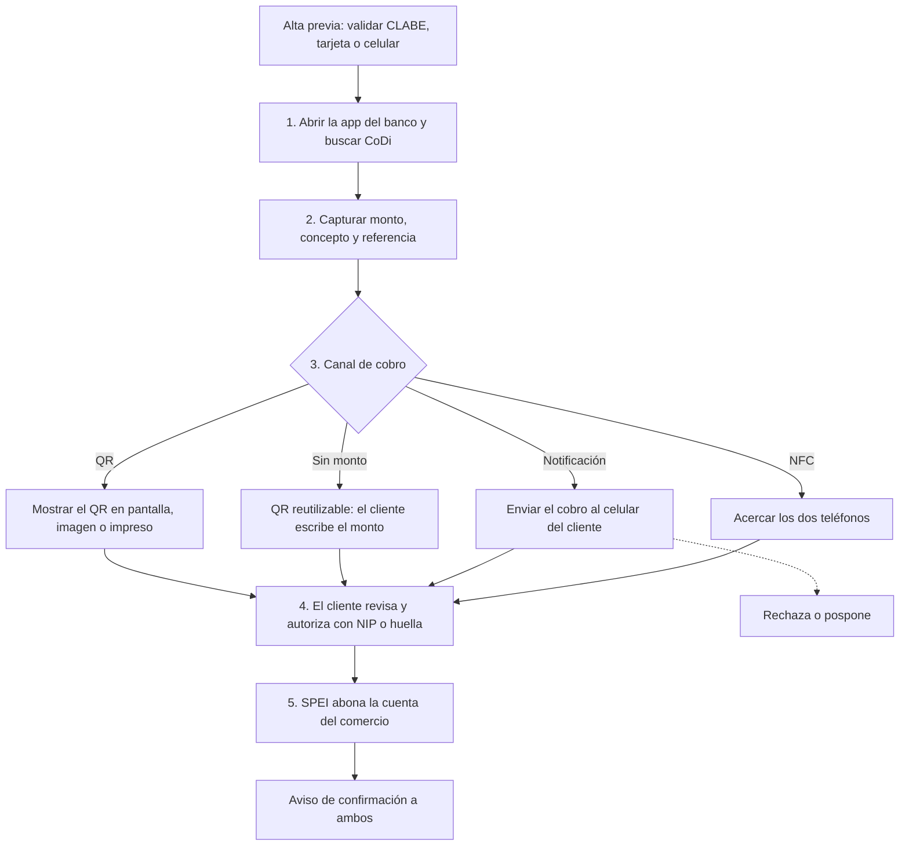

# Cobro CoDi en la app del banco

Recorrido actual, antes de Cody. El comercio arma el cobro dentro de la app de su banco. El cliente autoriza en la suya. SPEI abona la cuenta y los dos reciben confirmación.

